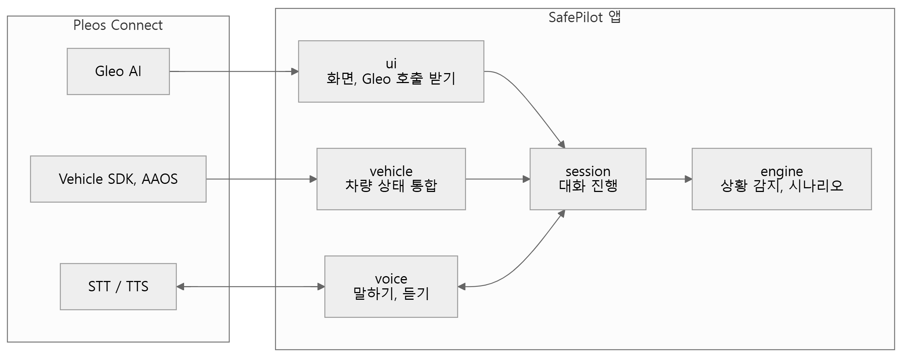
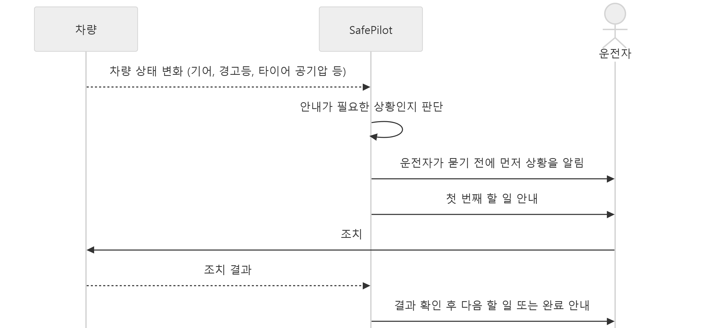
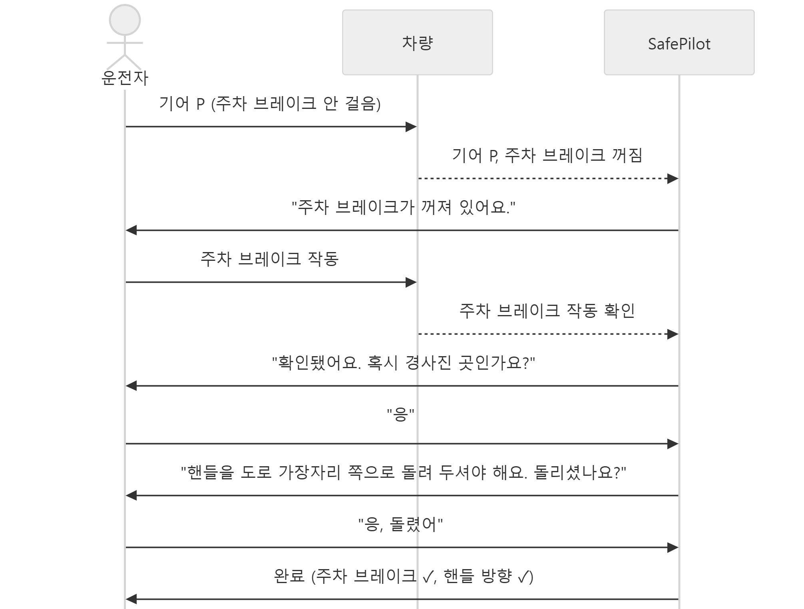
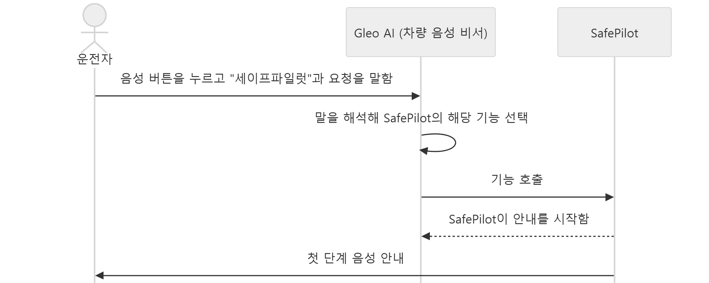
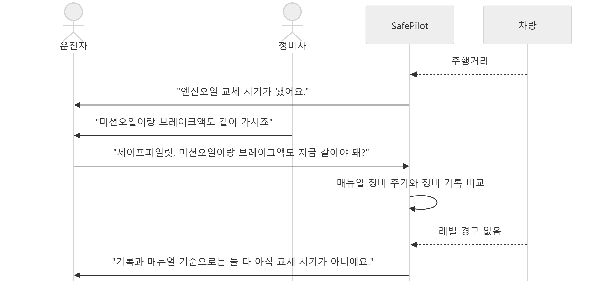
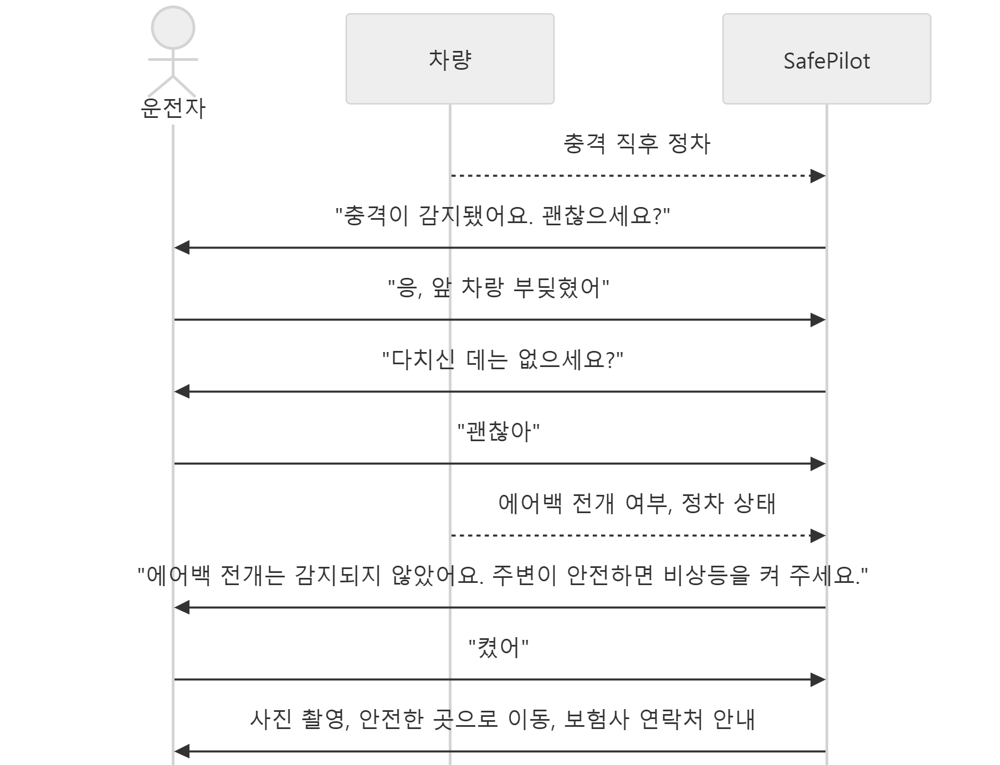

# SafePilot 앱 설계서

현대자동차그룹 차량용 앱 개발 공모전 출품작, 앱 버전 0.1.0, 2026년 11월

SafePilot은 Pleos Connect 차량 데이터로 운전자가 마주치는 상황을 먼저 감지하고, 해야 할 조치를 음성으로 하나씩 안내한 뒤 그 조치가 끝났는지를 차량 데이터로 확인하는 앱입니다. 이 문서는 기획서에서 다루지 못한 구현 수준의 설계를 담습니다. 차량 데이터를 어떻게 읽는지, 앱이 어떤 구조로 움직이는지, 각 시나리오가 어떤 규칙으로 진행되는지, 무엇을 시험했고 무엇이 아직 확인되지 않았는지를 적었습니다.

## 1. 범위

| 구분 | 내용 |
|---|---|
| 지금 동작하는 것 (0.1.0) | 경사로 주차 안내, 타이어 공기압 경고 안내, Gleo AI 음성 호출, 질문 직후 답 듣기, 예/아니요 버튼 |
| 1차 합격 후 구현 | 차량 등록과 정비 기록, 정비 권유 확인(기획서 시나리오 2), 접촉 사고(기획서 시나리오 3), 경고등 안내, 자동 세차 |
| 하지 않는 것 | 기어, 브레이크, 가속, 조향 등 모든 차량 제어. 호출어 상시 감지. 경고등 하나로 고장 부위를 확정하는 진단. 생성형 AI가 만든 안전 안내 |

시험 환경은 Pleos Connect Emulator 2.1.0(API 34)과 Pleos Virtual Console입니다. 실차에서는 아직 시험하지 못했습니다.

## 2. 설계 원칙

- **조회만 합니다.** 차량 데이터는 조회 권한으로만 읽습니다. 차량 제어 SDK는 쓰지 않습니다.
- **같은 상황에는 같은 안내를 합니다.** 안내 문장은 앱 안의 규칙이 만듭니다. 생성형 AI는 쓰지 않습니다. Gleo AI는 운전자의 말을 SafePilot 기능으로 연결하는 데까지만 관여합니다.
- **읽을 수 없으면 묻습니다.** 모든 차량 값은 "값 있음", "지원 안 함", "아직 모름" 세 가지 상태로 다룹니다. 지원하지 않는 값은 화면에 "확인 불가"로 표시하고 운전자에게 질문으로 확인합니다.
- **단정하지 않습니다.** "펑크일 수 있어요"처럼 가능성까지만 말합니다. 경사 여부, 핸들 방향처럼 앱이 알 수 없는 것은 운전자의 답으로 확인합니다.
- **네트워크 없이 동작합니다.** 음성 인식과 음성 합성은 기기 내 처리(ON_DEVICE)를 쓰고, 안내 규칙은 앱 안에 있습니다. Gleo 호출만 Gleo의 서버 인식을 씁니다.
- **주의 분산을 줄입니다.** 안내는 짧은 음성 한 문장과 큰 글씨 카드 한 장입니다. 앱은 상시로 듣지 않고, 앱이 질문한 직후 6초와 마이크 버튼을 눌렀을 때만 듣습니다.

## 3. 차량 데이터 매핑

2026년 11월 4일 Pleos Connect Emulator 2.1.0에서 값을 읽고, 변화를 구독하고, Virtual Console로 값을 바꿔 가며 확인한 결과입니다.

| 정보 | 읽는 방법 | 권한 | 에뮬레이터 결과 | 쓰는 곳 |
|---|---|---|---|---|
| 기어 | Pleos `Gear.getCurrentGearSelectionState`, `registerGearSelection` | `CAR_*` | 읽기와 변화 감지 됨 | P 진입 감지 |
| 속도 | AAOS `PERF_VEHICLE_SPEED` (m/s) | AAOS `CAR_SPEED` | 읽기와 변화 감지 됨 | 정차 판단 (1 km/h 미만) |
| 주차 브레이크 | Pleos 경고등 `PARKING_BRAKE`, `ELECTRONIC_PARKING_BRAKE` | `PRIVATE_CAR_SAFETY` | 됨 | 경사로 주차 시작과 조치 확인 |
| 주차 브레이크 (대체) | AAOS `PARKING_BRAKE_ON` | AAOS `CAR_POWERTRAIN` | 읽기 됨, 에뮬레이터에서 값 변경 불가 | 경고등 권한을 못 쓸 때 |
| TPMS 경고 | Pleos 경고등 `TPMS` | `PRIVATE_CAR_SAFETY` | 됨 | 타이어 시나리오 시작 |
| 바퀴별 공기압 | Pleos `Tire.getTirePressure`, `registerTirePressure` | `PRIVATE_CAR_SAFETY` | 에뮬레이터 미지원 | 어느 바퀴인지 안내 |
| 저압 기준값 | Pleos `Tire.getLowTirePressure` | `CAR_SAFETY` | 됨 (137 kPa) | 바퀴별 공기압과 비교 |
| 핸들 각도 | Pleos `SteeringWheel.getCurrentSteeringWheelAngle` | `CAR_*` | 됨 (Virtual Console과 부호 반대) | 화면 참고 정보 |
| 브레이크 페달 | Pleos `Brake.getCurrentBrakePedalStatus` | `CAR_DRIVE` | 됨 | 정차 판단 보조 |
| 주행거리 | Pleos `Odometer.getCurrentDistanceDriven` | `CAR_DRIVE` | 됨 | 정비 시기 (2단계) |
| 에어백 전개 | Pleos `Safety.hasSeatAirbagBeenDeployed` | `CAR_SAFETY` | 에뮬레이터 미지원 | 사고 안내 (2단계) |
| 오일, 브레이크액 레벨 | Pleos `Safety` 레벨 상태 | `CAR_SAFETY` | 에뮬레이터 미지원 | 정비 점검 신호 (2단계) |
| VIN | Pleos `CarInfo.getVINInfo` | `CAR_INFO` | 값이 "invalid" | 차종 후보 (2단계) |
| 가속도 | Android `SensorManager` (보정 전 가속도 센서) | 없음 | 가상 센서 값이 앱에 도착함 | 충격 감지 (2단계) |
| 비상등 | 읽을 방법 없음 | | 읽을 수 없음 | 운전자에게 묻기 |

- 경고등 조회는 공식 문서의 `CAR_SAFETY`만으로는 `SecurityException`이 나고 `PRIVATE_CAR_SAFETY`가 필요했습니다. 이 권한을 앱 마켓에서 쓸 수 있는지는 확인 중입니다. 쓸 수 없으면 주차 브레이크는 AAOS `PARKING_BRAKE_ON`으로 읽습니다.
- 충돌을 직접 알려 주는 API는 없습니다. 접촉 사고는 충격과 정차를 함께 보고 운전자에게 묻습니다(7.2절).
- Vehicle SDK 호출은 비동기입니다. 결과는 콜백으로 받고, 지원하지 않는 기능은 `Unsupported`로 바꿔 차량 상태에 넣습니다.

## 4. 앱 구조



| 패키지 | 주요 클래스 | 책임 |
|---|---|---|
| `vehicle` | `VehicleRepository`, `VehicleSnapshot` | Pleos Vehicle SDK와 AAOS 값을 하나의 차량 상태로 모아 흐름(StateFlow)으로 내보냄 |
| `engine` | `SituationDetector`, `SlopeParking`, `TireIssue`, `IntentClassifier` | 상태 변화에서 안내가 필요한 순간 찾기, 시나리오별 안내 단계 만들기, 운전자 말 분류 |
| `session` | `SessionController` | 안내 단계 진행, 차량 조건 기다리기, 답 기다리기, 재안내 |
| `voice` | `PleosSpeaker`, `PleosListener`, `GleoActions` | Pleos TTS와 STT, Gleo 호출 해석과 결과 회신 |
| `ui` | `MainActivity`, `AppViewModel`, `Screens` | 차량 상태 패널, 안내 카드, 예/아니요, 마이크, 질문 직후 듣기 |

`engine`은 차량 상태 모델만 알고 Android나 Pleos SDK를 모릅니다. 그래서 상황 감지와 시나리오 규칙을 가짜 차량 상태로 단위 테스트할 수 있습니다.

### 4.1 데이터 모델

```kotlin
sealed interface Known<out T> {              // 읽을 수 있는지까지 담은 값
    data class Value<T>(val value: T) : Known<T>
    data object Unsupported : Known<Nothing>  // 지원 안 함 → 운전자에게 묻기
    data object Pending : Known<Nothing>      // 아직 값이 안 옴
}

data class VehicleSnapshot(
    val gear: Known<Gear>, val speedKmh: Known<Float>,
    val parkingBrakeOn: Known<Boolean>, val autoHoldOn: Known<Boolean>,
    val tpmsWarning: Known<Boolean>, val tirePressureKpa: Known<Map<Wheel, Float>>,
    val lowTirePressureKpa: Known<Float>, val brakePedalPressed: Known<Boolean>,
    val airbagDeployed: Known<Boolean>, val steeringAngleDeg: Known<Float>,
    val odometerKm: Known<Float>,
)

data class GuidanceStep(val speech: String, val card: String,
                        val confirm: Confirm, val source: String?)

sealed interface Confirm {
    data class VehicleCondition(val reminder: String, val timeoutSec: Int = 20,
                                val check: (VehicleSnapshot) -> Boolean) : Confirm
    data class DriverAnswer(val onNo: Outcome) : Confirm
    data object None : Confirm
}
```

안내는 단계(`GuidanceStep`)의 목록입니다. 각 단계는 말할 문장, 화면 카드 문구, 확인 방법, 근거를 가집니다. 확인 방법은 세 가지입니다. 차량 데이터로 확인하는 단계(`VehicleCondition`), 운전자의 답으로 확인하는 단계(`DriverAnswer`), 말하고 바로 넘어가는 단계(`None`)입니다.

## 5. 대화 진행 규칙



`SessionController`는 대기(Idle), 안내 중(Guiding), 완료(Done) 세 상태로 움직입니다.

| 상황 | 규칙 |
|---|---|
| 안내 시작 | 차량 상태 변화 감지, Gleo 호출, 마이크 버튼, 화면 버튼 중 하나. 이미 안내 중이면 새 시작을 받지 않음 |
| 차량 값 준비 | 앱이 막 켜진 경우 차량 값이 들어올 때까지 최대 3초 기다린 뒤 시작 |
| 차량 데이터로 확인하는 단계 | 조건이 맞으면 다음 단계. 시간 안에 안 되면 한 번만 다시 안내 (주차 브레이크 20초, 정차 60초) |
| 답이 필요한 단계 | 질문 직후 6초 동안 마이크를 켬. 말하는 중이면 3초 더 기다림. 화면의 예/아니요 버튼으로도 답할 수 있음 |
| 답을 못 들었을 때 | 못 알아들었거나 20초 동안 답이 없으면 한 번만 다시 물음 |
| 아니라고 답했을 때 | 그 단계에 정해진 마무리 문장과 요약으로 끝냄 |
| 그만두기 | "그만", "취소"라고 하면 바로 끝냄. 주차 안내 중 기어가 P에서 벗어나면 안내를 멈춤 |
| 완료 | 완료 카드에 확인한 항목을 보여 주고 10초 뒤 대기로 돌아감 |

주행 중에는 Pleos가 앱 화면을 가립니다. 에뮬레이터에서 기어 D일 때 "주행 중에는 사용할 수 없습니다" 화면이 앱을 덮었고, 음성 안내는 계속 나왔습니다. 그래서 주행 중 안내는 음성으로만 하고, 화면은 정차 후에 봅니다.

### 5.1 음성 의도 분류

운전자의 짧은 말은 키워드 규칙으로 분류합니다(`IntentClassifier`). 생성형 AI를 쓰지 않습니다.

| 분류 | 예 | 규칙 |
|---|---|---|
| 그만 | 그만, 취소, 멈춰 | 가장 먼저 판정 |
| 타이어 | 타이어, 공기압, 펑크 | 시나리오 시작 요청 |
| 아니 | 아니, 안 걸었어, 평지, 아직 | "안 걸었어"가 "걸었어"를 포함하므로 부정을 긍정보다 먼저 판정 |
| 예 | 응, 네, 맞아, 돌렸어 | 한 글자 대답은 문장 첫 낱말일 때만 인정 |
| 주차 | 주차, 언덕, 경사 | 시나리오 시작 요청 |

## 6. 구현된 시나리오

### 6.1 경사로 주차 (기획서 시나리오 1)



- **시작 조건**: 기어가 P가 아닌 상태에서 P로 바뀌었고, 주차 브레이크가 걸려 있지 않음.
- **단계**
  1. "주차 브레이크가 꺼져 있어요." 주차 브레이크 경고등이 켜지면 다음 단계로 넘어갑니다. 주차 브레이크를 읽을 수 없으면 "주차 브레이크를 거셨나요?"라고 묻습니다.
  2. "확인됐어요. 혹시 경사진 곳인가요?" 경사는 차량 데이터로 알 수 없어 묻습니다. "아니"라고 하면 주차를 마칩니다.
  3. "경사진 곳에선 핸들을 도로 가장자리 쪽으로 돌려 두셔야 해요. 돌리셨나요?" 핸들 각도를 읽어도 도로의 어느 쪽이 가장자리인지는 알 수 없어 운전자의 답으로 확인합니다.
  4. 완료 카드: 주차 브레이크, 핸들 방향.
- **근거**: 도로교통법 시행령 제11조 제3항. 화면 카드에 근거를 표시합니다.
- P로 바꿀 때 주차 브레이크가 자동으로 걸리는 차에서는 시작 조건이 맞지 않아 안내하지 않습니다. 운전자가 직접 부르면 주차 브레이크가 걸려 있는지 보고 경사 여부부터 묻습니다.

### 6.2 타이어 공기압 경고

- **시작 조건**: TPMS 경고등이 켜짐, 또는 바퀴별 공기압이 저압 기준값보다 낮은 바퀴가 새로 생김.
- **단계**
  1. "타이어 공기압 경고가 켜졌어요. 펑크일 수 있어요." 바퀴별 공기압을 읽을 수 있으면 "앞 오른쪽 타이어 공기압이 낮아요"처럼 바퀴를 말합니다.
  2. 주행 중이면 "속도를 줄이고 안전한 곳에 차를 세워 주세요." 속도가 1 km/h 미만이 되면 다음 단계로 넘어갑니다. 60초 안에 멈추지 않으면 한 번 더 안내합니다.
  3. "정비소에서 점검을 받아 보세요." 타이어 하나만 바꿔도 되는지는 구동 방식과 다른 타이어의 마모 상태에 따라 달라 정비소에서 확인하도록 안내합니다.
  4. 완료 카드: 공기압 경고, 정차, 정비소 점검 필요.
- 에뮬레이터는 바퀴별 공기압을 주지 않아 TPMS 경고등으로 시작합니다.

### 6.3 Gleo AI 음성 호출



- 앱의 `assets/schema.json`에 호출 이름 "세이프파일럿"과 기능 2개(`CHECK_PARKING_SAFETY` 주차 확인, `EXPLAIN_TIRE_WARNING` 타이어 경고 안내)를 등록합니다.
- Gleo가 기능을 고르면 앱에 Intent를 보냅니다. 에뮬레이터에서는 action 앞에 패키지 이름이 붙어 왔습니다(`ai.safepilot.CHECK_PARKING_SAFETY`). 문서 예시와 달라 매니페스트에 두 형식을 모두 등록했습니다.
- 앱은 7초 안에 `APP_ACTION_RESPONSE`로 결과를 돌려줍니다. 안내는 SafePilot이 직접 말하므로 응답 모드는 `silent`입니다.
- 에뮬레이터에서 실제 음성 "세이프파일럿, 주차 확인해 줘"로 호출되는 것까지 확인했습니다. 정식 반영은 Pleos의 스키마 검토 후입니다.

## 7. 1차 합격 후 구현할 시나리오

### 7.1 정비 권유 확인 (기획서 시나리오 2)



- 차량 등록 때 차종, 연식, 가입 보험사, 최근 정비 시점을 입력받습니다. 차종과 연식은 VIN을 참고해 후보를 보여 주고 운전자가 확인합니다.
- 항목별로 매뉴얼의 정비 주기와 마지막 교체 기록을 비교해 "교체 시기", "아직 아님", "기록 없음"으로 보여 줍니다. 교체가 필요한지는 판정하지 않습니다.
- 오일, 브레이크액 레벨 경고는 교체 시기 판단에 쓰지 않고, 켜져 있으면 별도로 점검을 권합니다.
- 차종별 매뉴얼 정보는 앱 안의 JSON으로 두고, 항목마다 매뉴얼 출처를 기록합니다. 출처를 확인하지 못한 항목은 비워 두고 일반 안내로 대신합니다.

```json
{
  "model": "차종 이름",
  "maintenance": {
    "engine_oil": { "interval_km": null, "interval_months": null, "source": null }
  },
  "tire": { "drive": "AWD", "single_replacement": { "max_tread_diff_mm": null, "source": null } }
}
```

### 7.2 접촉 사고 (기획서 시나리오 3)



충돌 API가 없으므로 두 조건이 차례로 맞을 때 "충돌 의심"으로 보고 운전자에게 묻습니다.

| 순서 | 조건 | 데이터 |
|---|---|---|
| 1 | 충격: 진행 방향 또는 옆 방향 가속도가 약 0.1초 안에 기준치를 넘음 | 가속도 센서 |
| 2 | 정차: 충격 뒤 5초 안에 속도가 거의 0이 되고 2초 이상 이어짐 | 속도, 브레이크 페달 |

| 상황 | 충격 | 정차 | 판단 |
|---|---|---|---|
| 과속방지턱, 포트홀 | 있음 | 없음 | 무시 |
| 급브레이크 | 없음 | 있음 | 무시 |
| 접촉 사고 | 있음 | 있음 | "충격이 감지됐어요. 사고가 났나요?" |

- 운전자가 아니라고 하면 바로 끝냅니다. "세이프파일럿, 사고 났어"라고 말해서 시작할 수도 있습니다.
- 다쳤다고 답하면 119 번호와 통화 버튼을 보여 줍니다. 앱이 대신 전화를 걸지는 않습니다.
- 비상등은 앱이 읽을 수 없어 켰는지 묻습니다. 에어백을 읽을 수 없으면 "에어백 상태는 확인할 수 없어요"라고 말하고, 미전개를 괜찮다는 신호처럼 말하지 않습니다.
- 가속도 기준치는 실험으로 정합니다. 실차에서 가속도 센서를 쓸 수 없으면 충격 감지는 끄고 음성 시작만 제공합니다.

## 8. 화면

| 영역 | 내용 |
|---|---|
| 차량 상태 패널 | 기어, 속도, 주차 브레이크, 타이어 공기압, 에어백. 읽을 수 없는 값은 "확인 불가" |
| 대기 카드 | "차량 상태를 지켜보고 있어요"와 부르는 방법 안내, 주차 확인과 타이어 점검 버튼 |
| 안내 카드 | 상황 제목, 단계 목록(현재 단계 강조, 끝난 단계 체크), 현재 단계 문구, 근거, 예/아니요 버튼 |
| 완료 카드 | 확인한 항목 요약, 닫기 버튼 |
| 마이크 막대 | 듣는 중 표시와 인식된 말, 마이크 버튼 |

어두운 배경, 큰 글씨, 높은 대비, 짧은 문구로 만들고 애니메이션은 줄였습니다. Pleos 운전자 주의 분산 가이드를 따랐습니다.

## 9. 시험

| 종류 | 내용 |
|---|---|
| 단위 테스트 26개 | 의도 분류 예문, 상황 감지 조건, 시나리오 단계 구성, 읽을 수 없는 값 처리(`EngineTest` 17개). 경사로 주차 전체 흐름, 평지 답변, 재안내, 출발 시 중단, 정차 기다리기, 질문 직후 듣기, 무응답 재질문(`SessionControllerTest` 9개) |
| 에뮬레이터 시나리오 시험 | Virtual Console로 기어, 속도, 브레이크, 핸들 각도, 주차 브레이크와 TPMS 경고등을 바꿔 두 시나리오를 처음부터 끝까지 진행 |
| 음성 호출 시험 | PC 마이크를 에뮬레이터에 연결하고 Gleo에 실제로 말해서 호출 |
| 시연 영상 | 위 시험을 녹화한 화면과 앱의 실제 음성 (기획서 7번 링크) |

## 10. 빌드와 실행

- 개발 환경: Kotlin 2.0.0, Jetpack Compose, JDK 17, Gradle 8.10.2, AGP 8.8.2, compileSdk와 targetSdk 35, minSdk 28 (Pleos 요건)
- Pleos SDK: Vehicle 2.3.2, SpeechToText 3.3.1, TextToSpeech 3.3.1
- 설치: `adb install -r -g apk/SafePilot_release.apk`
- 시나리오 재현 방법과 권한 목록은 GitHub 저장소의 README에 있습니다.

## 11. 확인 중인 것과 대체 방법

| 항목 | 영향 | 대체 방법 |
|---|---|---|
| `PRIVATE_CAR_SAFETY` 사용 승인 | 경고등(주차 브레이크, TPMS), 바퀴별 공기압 | 주차 브레이크는 AAOS `PARKING_BRAKE_ON`으로 읽음 |
| 실차의 바퀴별 공기압, 에어백, 오일 레벨 | 타이어 바퀴 안내, 사고와 정비 안내 | 지원하지 않으면 "확인 불가" 표시 후 운전자에게 묻기 |
| 실차의 가속도 센서 제공 | 충돌 의심 자동 감지 | 음성으로 사고 안내 시작 |
| 주행 중 사용 허가 선언 방법 | 주행 중 화면 안내 | 주행 중에는 음성으로만 안내하고 화면은 정차 후 |
| 핸들 각도 부호 규약 | 화면 참고 정보 | 핸들 방향은 운전자의 답으로 확인하므로 안내에는 영향 없음 |
| 차종별 매뉴얼 근거 | 정비 주기, 세차 절차 | 출처를 확인한 항목만 쓰고 나머지는 일반 안내 |

## 부록. 참고 문서

- Pleos Connect SDK: https://document.pleos.ai/docs/pleos-only/connect-sdk-pleos/
- Vehicle SDK: https://document.pleos.ai/docs/pleos-only/connect-sdk-pleos/Vehicle/intro
- AAOS 표준 데이터: https://document.pleos.ai/docs/pleos-only/vehicle-app-planning-guide/pleos-connect-sdk-api
- STT와 TTS: https://document.pleos.ai/docs/pleos-only/connect-sdk-pleos/SpeechToText/intro
- Gleo Interface: https://document.pleos.ai/docs/pleos-only/app-integration-guide/guide/core-concepts
- 주행 규제: https://document.pleos.ai/docs/pleos-only/vehicle-app-planning-guide/driving-restiction-policy
- 운전자 주의 분산 가이드: https://document.pleos.ai/docs/pleos-only/vehicle-app-planning-guide/driver-distraction-guideline
- Virtual Console: https://document.pleos.ai/docs/pleos-only/app-test-guide/virtual-console-guide
- 도로교통법 시행령 제11조(정차 또는 주차의 방법 등)
