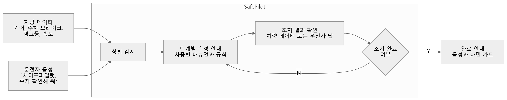
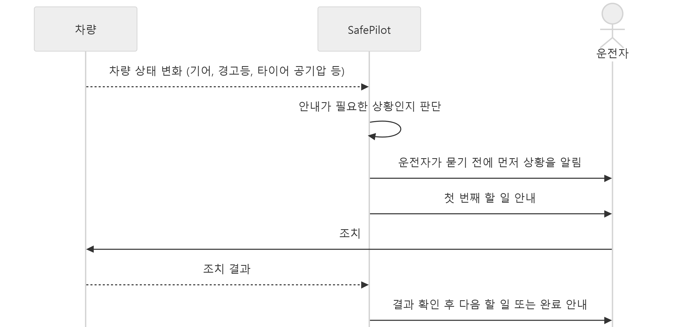
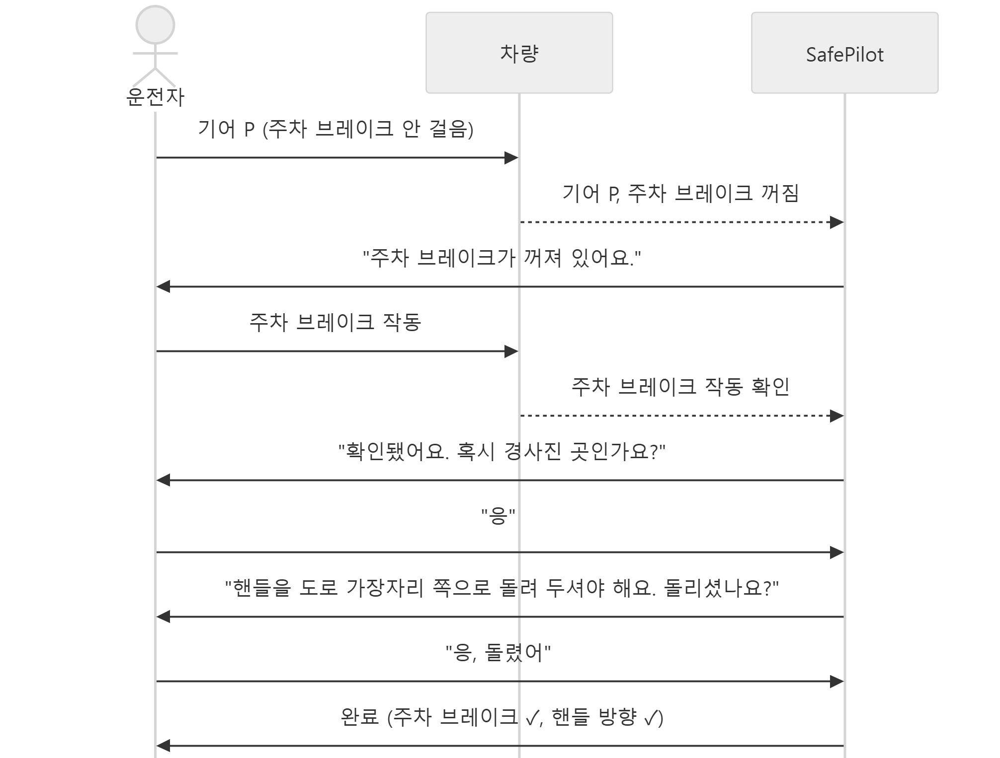
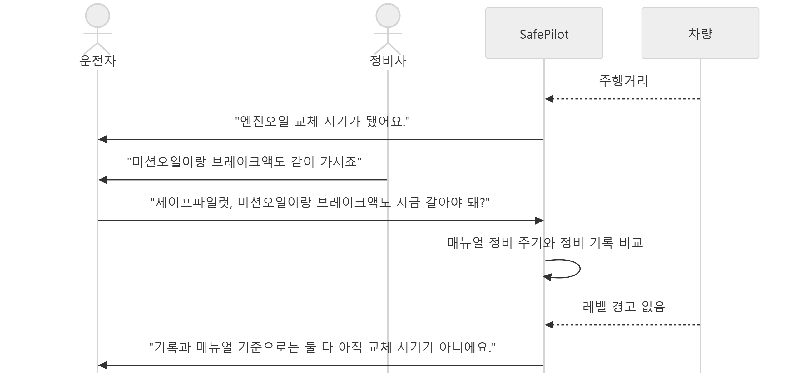
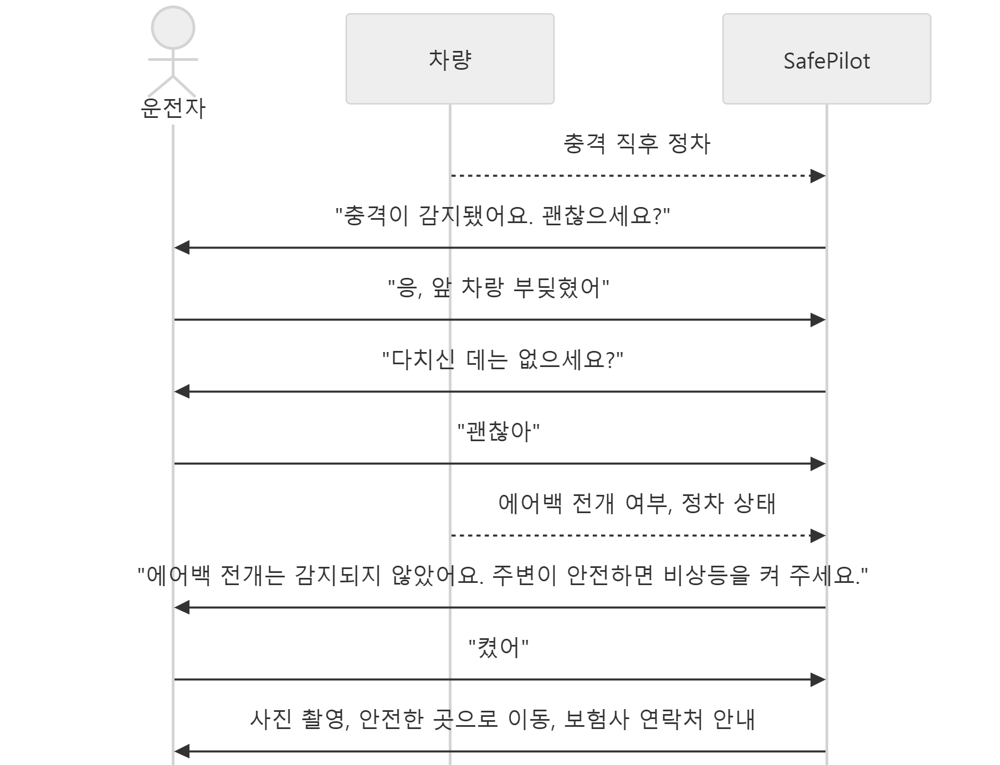
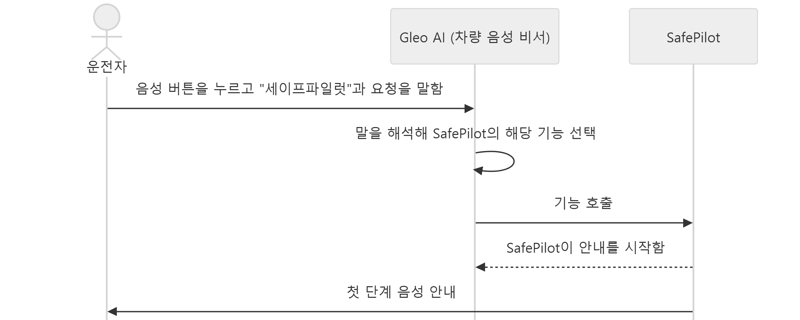
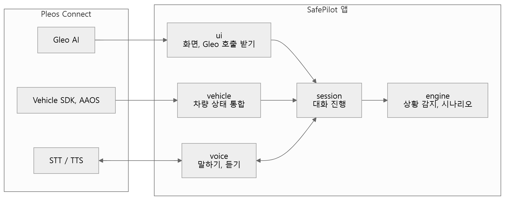

# SafePilot 기획서 본문 (접수양식 02장 1~8번)

<!-- fill_form.py가 "## N." 제목 아래 내용을 양식의 N번 박스에 넣는다.
     "- "로 시작하는 줄은 글머리표, "**...**"만 있는 줄은 굵은 소제목. 빈 줄은 문단 구분. -->

앱명: SafePilot (세이프파일럿)

## 1. 앱 한 줄 소개

Pleos Connect 차량 데이터로 주차, 타이어, 사고처럼 운전자가 마주치는 상황을 먼저 감지하고, 차종별 매뉴얼에 맞는 대처를 음성으로 안내하며 필요한 조치를 마쳤는지까지 확인해 주는 운전 파트너 앱입니다.

## 2. 기획 배경

**대상 고객**

운전 중에 발생하는 여러 가지 상황에서 도움이 필요한 모든 운전자가 대상입니다.

**불편한 순간**

- 알면서도 놓치는 순간: 늘 하던 확인도 서두르거나 다른 데 신경 쓰다 보면 빠뜨립니다.
- 차량 지식이 깊지 않아 판단하기 어려운 순간: 정비 권유나 경고 표시가 내 차에 어떤 의미인지 알기 어렵습니다.
- 무엇부터 해야 할지 모르는 순간: 경사로 주차나 사고 직후처럼 자주 겪지 않는 상황에서는 해야 할 일과 순서를 떠올리기 어렵습니다.

**해결이 필요한 이유**

- 운전자가 먼저 찾아야 합니다: 매뉴얼과 검색은 문제를 알아차려야 쓸 수 있는데, 놓친 것은 알아차리기 어렵고 운전석에서 바로 찾기도 어렵습니다.
- 내 차의 상태를 반영하지 못합니다: 검색 결과에는 내 차의 차종과 현재 상태가 반영되지 않습니다. 내 차의 상태는 차량 데이터로 판단할 수 있습니다.
- 잊거나 모르면 안전과 비용 문제로 이어집니다: 주차 브레이크 거는 것을 잊으면 차가 밀릴 수 있고, 정비가 지금 필요한지 모르면 쓰지 않아도 될 비용을 쓸 수 있습니다.

그래서 차량 데이터로 안내가 필요한 순간을 먼저 알아채 운전자에게 알려 주고, 차종별 매뉴얼대로 할 일을 짚어 주는 앱이 필요합니다.

## 3. 앱 주요 기능 및 차량 특화 요소

**주요 기능**

- 먼저 알리기: 기어 변화, 주차 브레이크, 경고등, 타이어 공기압, 에어백 전개, 속도와 정차 같은 차량 상태 변화를 감지해, 운전자가 묻기 전에 SafePilot이 먼저 상황을 알리고 필요한 조치를 묻습니다. 운전자는 "응", "아니"처럼 말로 답합니다.

- 단계별 음성 안내: 할 일을 한 번에 하나씩 음성과 큰 글씨 카드로 안내합니다.
- 조치 결과 확인: 운전자가 조치하면 차량 데이터로 확인하고 다음 단계로 넘어갑니다. 예를 들어 주차 브레이크를 걸면 경고등이 켜진 것을 보고 "확인됐어요"라고 말합니다. 차량 데이터로 확인할 수 없는 조치는 운전자에게 묻습니다.
- 운전자가 부를 때: 차량 음성 비서 Gleo AI에게 "세이프파일럿, 주차 확인해 줘"처럼 앱 이름과 요청을 말하면 Gleo가 SafePilot을 열고 해당 안내를 시작합니다.
- 음성 질문: SafePilot에 "이 정비 지금 해야 돼?", "이 경고등은 뭐야?"처럼 정비와 경고등을 물으면 차종별 매뉴얼, 등록된 정비 기록, 주행거리와 차량 상태를 근거로 답합니다.
- 차량 등록과 정비 기록: 처음 사용할 때 운전자가 차종, 연식, 가입 보험사를 확인하고, 정비를 받으면 기록을 남깁니다. 차종과 연식은 VIN을 참고해 후보를 보여 주고 운전자가 최종 확인합니다.
- 차종별 매뉴얼 정보: 차종마다 다른 정비 주기, 경고등 대응 방법, 타이어 점검과 교체 때 확인할 조건을 매뉴얼 출처와 함께 앱에 담습니다.

**차량 특화 요소**

- 내 차의 상태를 근거로 말합니다. 같은 질문에도 관련 경고등, 주행거리, 정비 기록에 따라 답이 달라집니다.
- 차량을 조작하지 않습니다. 기어, 브레이크, 조향은 운전자가 하고 SafePilot은 안내와 확인만 합니다. 차량 데이터는 조회 권한으로만 읽고 차량 제어 기능은 쓰지 않습니다.
- 운전자 주의 분산을 줄입니다. 화면에서 앱을 열지 않아도 차량 음성 비서로 부를 수 있습니다. 안내는 음성으로 짧게 하고, 화면 버튼은 크게 만듭니다. 앱은 상시로 듣지 않고, 앱이 질문한 직후 몇 초만 답을 듣습니다. 화면은 정차와 주차 중에 보고, 주행 중에는 음성으로만 안내합니다.
- 사고 여부와 정비 필요 여부는 앱이 판정하지 않습니다. 충돌을 직접 알려 주는 API가 없어서 충격이 감지되면 "충격이 감지됐어요. 사고가 났나요?"라고 묻습니다. 정비는 매뉴얼의 정비 주기와 교체 기록을 보여 줍니다.
- 안전 안내는 생성형 AI가 지어내지 않습니다. 정해진 규칙과 차종별 매뉴얼 정보에 따라 같은 상황에는 늘 같은 안내를 합니다. 매뉴얼 정보와 안내 규칙은 앱 안에 저장되어 네트워크가 끊겨도 조회할 수 있습니다.

## 4. 주요 사용 시나리오

**시나리오 1. 경사로 주차 (운전 경험이 적은 초보 운전자)**

- 상황: 운전자가 언덕길에 차를 세우고 기어를 P로 바꿨지만 주차 브레이크는 걸지 않았습니다.
- P로 바꿀 때 주차 브레이크가 자동으로 걸리는 차에서는 안내가 시작되지 않습니다. 운전자가 직접 부르면 경사 여부부터 묻습니다. 핸들 방향은 운전자가 직접 돌려야 하므로 모든 차에서 안내합니다.
- 경사 여부와 핸들 방향은 차량 데이터로 알 수 없어 운전자에게 묻고, 확인이 끝나면 완료 화면을 보여 줍니다.
- 근거: 도로교통법 시행령 제11조 제3항(경사진 곳에 주차할 때 주차 브레이크를 작동한 뒤 미끄럼 방지 조치)

**시나리오 2. 정비 권유 확인 (차량 관리에 자신이 없는 운전자)**

- 상황: 운전자는 차량 등록 때 최근 정비 시점을 입력했고, 이후 정비를 받을 때마다 기록을 남겼습니다. 엔진오일 교체 시기가 가까워져 정비소에 갔다가 다른 소모품 교체도 함께 권유받습니다.
- SafePilot은 교체가 필요한지 판정하지 않고, 매뉴얼의 정비 주기와 마지막 교체 기록을 함께 보여 줍니다. 차량 상태에 따른 판단은 정비사와 상의하도록 안내합니다.
- 화면에는 항목별로 정비 주기, 마지막 교체 기록, "교체 시기", "아직 아님", "기록 없음"을 보여 줍니다. 브레이크액 레벨 경고처럼 관련 경고가 켜져 있으면 교체 시기와 관계없이 점검을 권합니다.
- 근거: 차종별 매뉴얼의 정비 주기

**시나리오 3. 접촉 사고 (갑작스러운 상황에 당황한 운전자)**

- 상황: 주행 중 충격이 있고 곧바로 차가 멈춥니다.
- 충격만으로 사고라고 보지 않고 먼저 묻습니다. 운전자가 사고가 아니라고 하면 바로 끝냅니다. 운전자가 "세이프파일럿, 사고 났어"라고 말해서 시작할 수도 있습니다.
- 다쳤다고 답하면 119 번호와 통화 버튼을 바로 보여 줍니다. 보험사 연락처는 차량 등록 때 고른 보험사의 사고 접수 번호를 보여 줍니다.
- 충격 감지는 가속도 센서 검증 뒤 적용하고, 그 전에는 운전자의 음성으로 시작합니다.
- 근거: 도로교통법 제54조(사고 발생 시 조치)

**그 밖의 상황**

- 타이어 저압 경고: 바퀴별 공기압을 읽을 수 있으면 어느 바퀴인지 알려 주고 "펑크일 수 있어요. 안전한 곳에 세운 뒤 점검을 받아 보세요"라고 안내합니다. 타이어 하나만 바꿔도 되는지는 구동 방식과 다른 타이어의 마모 상태에 따라 다르므로, 매뉴얼의 조건을 보여 주고 정비소에서 확인하도록 안내합니다.
- 경고등: 켜진 경고등의 종류, 색, 매뉴얼 지침에 따라 의미와 대응을 안내합니다. 고장 부위를 확정하지는 않습니다.
- 자동 세차: "자동 세차 들어가려고"라고 말하면 매뉴얼의 세차 절차를 차례로 안내하고 창문이 닫혔는지 확인합니다.

## 5. 개발 계획

**개발 환경**

- Pleos Connect(Android Automotive OS), Kotlin, Jetpack Compose, minSdk 28(Pleos 요건) / targetSdk 35
- Pleos Connect Emulator 2.1.0(API 34)과 Virtual Console로 기어, 속도, 브레이크, 핸들 각도, 경고등을 바꿔 가며 시험합니다. 충격은 에뮬레이터 가속도 센서에 값을 넣어 시험합니다.

**SDK / API 사용 계획**

- Pleos Vehicle SDK
  - Gear: 기어 상태와 변화 구독
  - Safety: 경고등 조회와 변화 구독(주차 브레이크, 오토홀드, TPMS 등), 에어백 전개 여부, 엔진오일과 브레이크액 레벨
  - Tire: 바퀴별 공기압과 저압 기준값
  - SteeringWheel: 핸들 각도(읽기만 하고 안내에는 쓰지 않음)
  - Brake: 브레이크 페달 상태(정차 판단 보조)
  - Odometer: 주행거리(정비 시기 판단)
  - 창문 상태: 자동 세차 전 창문 닫힘 확인
  - CarInfo: VIN(차종 후보 제시, 차량 등록 화면에서 운전자가 최종 확인)
- Gleo Interface(Gleo AI 연동): 앱에 App Schema를 넣어 호출 이름 "세이프파일럿"과 기능 2개(주차 확인, 타이어 경고 안내)를 등록합니다. Gleo가 운전자의 말을 해석해 앱을 열면 안내를 시작하고 결과를 Gleo에 돌려줍니다. 에뮬레이터에서 실제 음성 호출까지 확인했고, 정식 반영은 Pleos의 스키마 검토 후입니다.

- Pleos STT/TTS(SpeechToText, TextToSpeech): 한국어, 기기 내 처리(ON_DEVICE)로 네트워크 없이 동작. 앱이 질문한 직후 몇 초와 마이크 버튼을 눌렀을 때만 듣습니다.
- AAOS CarPropertyManager: 속도(PERF_VEHICLE_SPEED), 주차 브레이크 상태(PARKING_BRAKE_ON)
- Android SensorManager: 가속도 급변(충격) 감지
- 차량 제어 API는 쓰지 않습니다.

**확인 중인 것과 대체 방법**

- 공통 원칙: 모든 차량 데이터는 지원 여부를 먼저 확인하고, 지원하지 않으면 "확인 불가"로 표시한 뒤 운전자에게 묻습니다.
- 경고등 권한: 경고등 조회와 바퀴별 공기압은 PRIVATE_CAR_SAFETY 권한이 필요해 사용 가능 여부를 확인하고 있습니다. 쓸 수 없으면 주차 브레이크는 AAOS PARKING_BRAKE_ON으로 읽습니다.
- 에뮬레이터가 지원하지 않는 데이터: 에어백 전개, 엔진오일과 브레이크액 레벨, 바퀴별 공기압은 API는 있지만 에뮬레이터에서 값이 나오지 않습니다. 실차에서 확인하고, 그 전에는 "확인 불가"로 표시한 뒤 운전자에게 묻습니다.
- 비상등: 앱에서 읽을 수 없어 운전자에게 켰는지 묻습니다.
- 핸들 방향: 각도를 읽어도 도로의 어느 쪽이 가장자리인지는 앱이 알 수 없으므로 운전자에게 묻습니다.
- 가속도 센서: 에뮬레이터에서는 보정 전 가속도 센서로 시험했고, 실차 제공 여부를 확인한 뒤 적용합니다. 쓸 수 없으면 사고 안내는 음성으로 시작합니다.
- 주행 중 사용 허가: 에뮬레이터에서 주행 중에는 Pleos가 앱 화면을 가리고 "주행 중에는 사용할 수 없습니다"를 표시했고, 음성 안내는 계속 나왔습니다. 허가 방법을 확인하기 전까지는 정차와 주차 중 사용을 기준으로 하고, 주행 중에는 음성으로만 안내합니다.

**앱 구조**

- vehicle: Vehicle SDK와 AAOS 데이터를 하나의 차량 상태로 통합(VehicleRepository, VehicleSnapshot)
- engine: 상황 감지, 시나리오별 안내 단계, 음성 의도 분류(SituationDetector, Scenarios, IntentClassifier)
- session: 안내, 결과 확인, 답 듣기로 이어지는 대화 진행(SessionController)
- voice: Pleos STT/TTS로 말하기와 듣기, Gleo AI 호출 해석과 결과 회신(PleosSpeaker, PleosListener, GleoActions)
- ui: 차량 상태, 안내 카드, 예/아니요, 마이크 화면, Gleo AI 호출 받기
- 1차 합격 후 추가: 차종별 매뉴얼 정보(JSON)와 차량 등록, 정비 기록

**일정**

- 11/4~11/7(완료): 개발 환경 구축, 에뮬레이터에서 차량 데이터 조회 검증, 앱 골격, STT/TTS 연결, 경사로 주차와 타이어 저압 시나리오, Gleo AI 음성 호출 구현
- 11/8~11/15(완료): 화면 다듬기, 시연 영상, GitHub 저장소와 APK 준비, 기획서 제출
- 1차 합격 후(~12/2): 차량 등록과 정비 기록, 정비 권유 확인, 경고등, 자동 세차 시나리오 추가. 사고 안내는 가속도 센서 검증 결과에 따라 충격 감지형 또는 음성 시작형으로 구현

## 6. 기대효과 및 발전 가능성

**사용자 가치**

- 안전: 주차 브레이크를 깜빡하거나 사고 직후 할 일을 놓치는 실수를 줄입니다.
- 비용: 매뉴얼의 정비 주기와 내 정비 기록을 근거로, 권유받은 정비가 지금 필요한지 판단하도록 돕습니다.
- 안심: 초보 운전자, 매뉴얼을 찾아보기 어려운 고령 운전자도 내 차에 맞는 안내를 음성으로 받습니다.

**타깃 고객**

- 시장: Pleos Connect 탑재 차량 운전자. 현대자동차그룹은 2026년 5월 출시한 더 뉴 그랜저부터 Pleos Connect를 적용했고, 2030년까지 약 2,000만 대로 넓힐 계획입니다(2026년 4월 언론 보도).
- 주요 사용자층: 모든 운전자가 쓸 수 있고, 초보 운전자, 고령 운전자, 차량 관리에 자신이 없는 운전자에게 특히 도움이 됩니다. 새 차로 바꿔 기능과 관리 방법을 다시 익혀야 하는 운전자도 마찬가지입니다.

**예상 MAU와 Retention (검증 전 가정)**

- SafePilot은 필요한 상황에서 먼저 알리는 앱이라 운전자가 직접 여는 일이 적습니다. 그래서 실행 횟수 대신 안내를 받은 차량 수로 활성 사용을 셉니다.
- 가정: 국내 Pleos Connect 탑재 차량 100만 대 시점, 앱 설치율 10%(10만 대).
- MAU: 월 1회 이상 안내를 받는 차량을 40%로 가정하면 월간 활성 차량 약 4만 대입니다.
- Retention: 설치 6개월 뒤에도 월 1회 이상 안내를 받는 차량 비율로 정의하고, 목표는 60%로 잡습니다.
- 설치율, 활성 비율, Retention은 아직 참고할 데이터가 없어 가정한 값입니다. 시범 운영에서 상황별 안내 발생률을 측정해 다시 산정합니다.

**발전 가능성**

- 지원 차종 확대: Pleos Connect 탑재 차종 중 매뉴얼과 차량 데이터 동작을 검증한 차종부터 차례로 넓힙니다.
- 상황 확대: 고속도로 긴급 정차, 겨울철 배터리 관리 등을 추가합니다. 주행 중 안내는 사용 허가 요건을 확인한 뒤 넣습니다.
- 음성 호출 확대: 지금은 주차 확인과 타이어 경고 안내를 Gleo AI로 부를 수 있습니다. 사고 안내까지 넓혀 "세이프파일럿, 사고 났어"로 바로 시작하게 합니다.
- 서비스 연계: 처음에는 보험사 사고 접수 번호와 통화 버튼을 보여 주고, 공식 제휴가 생기면 사고 접수, 정비 예약, 긴급출동과 직접 연결합니다.
- 해외 확대: Pleos Connect가 해외 시장에 적용되면 다국어와 국가별 교통 규정을 지원합니다.

## 7. 참고자료

- 앱 설계서: SafePilot_설계서.pdf 첨부(차량 데이터 매핑, 앱 구조, 대화 진행 규칙, 시나리오별 설계, 시험 결과). GitHub 저장소 docs 폴더에도 있습니다.
- 시연 영상(화면 녹화): https://youtu.be/-JhT-_ZUvT0
- GitHub 저장소(소스 코드, apk/ 폴더의 release APK): https://github.com/rex-next-labs/SafePilot

## 8. 숏폼 링크

https://youtube.com/shorts/_4Q8Jee1VaQ (#HMG차량용앱개발공모전)
